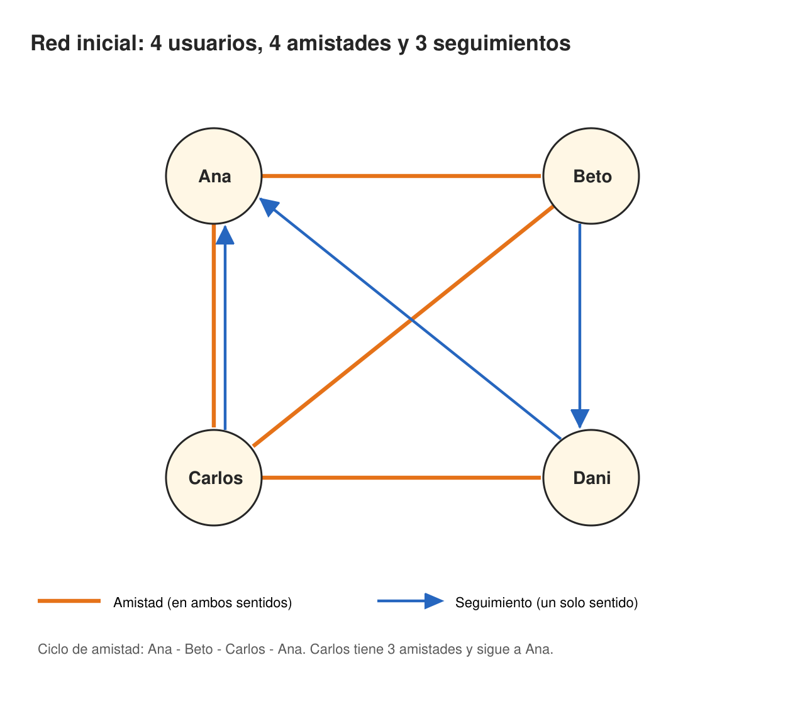
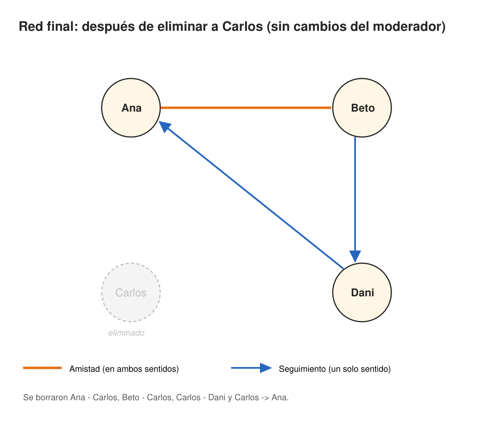

# Red social con grafo dinámico · Grupo 2

Estructura de Datos · 3.er semestre de Software · FISEI, Universidad Técnica de Ambato
Docente: Ing. José Caiza, Mg. · Actividad facilitada por el Grupo 5 · jueves 19/11/2026

**Objetivo:** simular el funcionamiento de un grafo dinámico mediante la creación, modificación y eliminación de usuarios y relaciones.

**Producto final:** una red social actualizada y correctamente representada, en Padlet y en un programa Java.

## Contenido

1. [Integrantes](#integrantes)
2. [La actividad](#la-actividad)
3. [Modelo del grafo](#modelo-del-grafo)
4. [Red inicial](#red-inicial)
5. [Modificaciones del moderador](#modificaciones-del-moderador)
6. [Eliminación de Carlos](#eliminación-de-carlos)
7. [Red final](#red-final)
8. [Estructura del código](#estructura-del-código)
9. [Cómo compilar y ejecutar](#cómo-compilar-y-ejecutar)
10. [Capturas de funcionamiento](#capturas-de-funcionamiento)
11. [Referencias](#referencias)

## Integrantes

| Integrante | Asistencia | En la actividad | Clases que programa |
|---|---|---|---|
| Damian Cunalata | Presente | Eliminar a Carlos y publicar el esquema | `negocio/RedSocial` y README |
| Josue Jampier Camacho | Presente | Amistades y seguimientos con comentarios | `pruebas/PruebasRedSocial` |
| Darwin Tisalema | Presente | Modificaciones del moderador | `app/Main` |
| Luis Silva | Presente | Crear los cuatro usuarios | `enums`, `modelo` y `app/Menu` |
| Kenneth Chalco | **No asistió** | — | — |
| Mónica Tacuri | **No asistió** | — | — |

Qué debe hacer cada uno, paso a paso: [`docs/REPARTO.md`](docs/REPARTO.md).

### Integrantes que no asistieron

Kenneth Chalco y Mónica Tacuri faltaron a la clase del jueves 19/11/2026, por lo que no participaron en la actividad y no se les asignó una parte.

## La actividad

| Paso | Instrucción | Responsable |
|---|---|---|
| 1 | Crear cuatro usuarios: Ana, Beto, Carlos y Dani. | Luis |
| 2 | Establecer amistades y seguimientos entre ellos con comentarios. | Jampier |
| 3 | Modificar las relaciones siguiendo las indicaciones del moderador. | Joel |
| 4 | Eliminar a Carlos y todas sus conexiones. | Damian |
| 5 | Publicar un esquema de cómo quedó la red social. | Damian |

### Reglas

| Regla | Cómo se cumple |
|---|---|
| No hay amistad de una persona consigo misma. | `agregarAmistad` y `seguir` rechazan cuando los dos usuarios son el mismo. |
| Una amistad funciona en ambos sentidos. | Se guarda en la lista de los dos usuarios y se borra de las dos. |
| Un seguimiento funciona en una sola dirección. | Se guarda solo en la lista de quien sigue. |
| Al eliminar un usuario desaparecen todas sus conexiones. | `eliminarPersona` recorre la lista de todos los usuarios y borra las aristas que llegan al eliminado. |

## Modelo del grafo

| Elemento del grafo | En la red social | Clase |
|---|---|---|
| Vértice | Usuario (Ana, Beto, Carlos, Dani) | `Vertice` guarda una `Persona` |
| Arista no dirigida | Amistad | dos `Arista` de tipo `AMISTAD`, una en cada usuario |
| Arista dirigida | Seguimiento | una `Arista` de tipo `SEGUIR` en quien sigue |

Como tiene aristas no dirigidas y dirigidas sobre los mismos usuarios, es un **grafo mixto**. Se representa con una **lista de adyacencia de nodos propios** (sin `HashMap`, `HashSet`, `ArrayList` ni `LinkedList`): una lista enlazada de usuarios y, colgada de cada uno, su lista enlazada de relaciones.

```
cabeza -> [Ana] -> [Beto] -> [Carlos] -> [Dani] -> null          lista de usuarios
            |
            +-> (Beto, AMISTAD) -> (Carlos, AMISTAD) -> null      relaciones de Ana
```

## Red inicial



| Usuario | Amigos | Sigue a | Lo siguen |
|---|---|---|---|
| Ana | Beto, Carlos | — | Dani, Carlos |
| Beto | Ana, Carlos | Dani | — |
| Carlos | Ana, Beto, Dani | Ana | — |
| Dani | Carlos | Ana | Beto |

- 4 amistades: Ana — Beto, Ana — Carlos, Beto — Carlos y Carlos — Dani.
- 3 seguimientos: Dani → Ana, Beto → Dani y Carlos → Ana.
- Hay un ciclo de amistad: Ana — Beto — Carlos — Ana.

## Modificaciones del moderador

Cada indicación se revisa contra las reglas antes de aplicarla.

| # | Indicación del moderador | ¿Válida? | Regla | Cambio hecho |
|---|---|---|---|---|
| 1 | *[COMPLETAR en clase]* | | | |
| 2 | | | | |
| 3 | | | | |

## Eliminación de Carlos

Antes de eliminar a Carlos se listan todas sus conexiones. Con la red inicial, sin cambios del moderador, son:

| Conexión | Tipo | Se borra de |
|---|---|---|
| Ana — Carlos | Amistad | la lista de Ana y la de Carlos |
| Beto — Carlos | Amistad | la lista de Beto y la de Carlos |
| Carlos — Dani | Amistad | la lista de Carlos y la de Dani |
| Carlos → Ana | Seguimiento | la lista de Carlos |

Después de eliminarlo, ningún usuario lo tiene como amigo ni lo sigue, y Carlos ya no está en la lista de usuarios.

## Red final



| Usuario | Amigos | Sigue a | Lo siguen |
|---|---|---|---|
| Ana | Beto | — | Dani |
| Beto | Ana | Dani | — |
| Dani | — | Ana | Beto |

> Esta es la red esperada si el moderador no pide cambios. Si los pide, el esquema se actualiza con la bitácora de arriba.

## Estructura del código

Misma distribución de paquetes que el repositorio del Grupo 5. Las capas van en un solo sentido: `app -> negocio -> modelo -> enums`.

```
src/
  enums/    TipoRelacion.java       AMISTAD (no dirigida) y SEGUIR (dirigida)       Luis
  modelo/   Persona.java            usuario y nombre                                Luis
            Vertice.java            persona, su lista de relaciones y el siguiente  Luis
            Arista.java             destino, tipo de relación y la siguiente        Luis
  negocio/  RedSocial.java          operaciones del grafo dinámico                  Damian
  app/      Main.java               la actividad paso a paso                        Joel
            Menu.java               menú de consola con switch                      Luis
  pruebas/  PruebasRedSocial.java   pruebas sin JUnit de las reglas                 Jampier
docs/
  REPARTO.md                        qué hace cada integrante
  img/                              esquemas de la red y capturas
```

### Operaciones de `RedSocial`

| Operación | Qué hace | Rechaza (devuelve `false` o `null`) |
|---|---|---|
| `registrarPersona(usuario, nombre)` | Agrega un usuario. | Usuario vacío o repetido. |
| `agregarAmistad(a, b)` | Crea la amistad en los dos sentidos. | Lazo, usuario inexistente o amistad repetida. |
| `eliminarAmistad(a, b)` | La quita de los dos lados. | No eran amigos o usuario inexistente. |
| `seguir(a, b)` | `a` empieza a seguir a `b`. | Lazo, usuario inexistente o seguimiento repetido. |
| `dejarDeSeguir(a, b)` | Quita el seguimiento de `a` a `b`. | No lo seguía o usuario inexistente. |
| `eliminarPersona(usuario)` | Borra al usuario y todas sus conexiones. | Usuario inexistente. |
| `listarAmigos` / `listarSeguidos` / `listarSeguidores` | Vecinos de un usuario. | Usuario inexistente. |
| `mostrarRed()` | Una línea por usuario con sus amigos y a quién sigue. | — |

## Cómo compilar y ejecutar

Requiere JDK 17 o superior. Desde la raíz del repositorio, en PowerShell:

```powershell
javac -encoding UTF-8 -d out (Get-ChildItem -Recurse -Filter *.java src).FullName
java -cp out app.Main                 # la actividad paso a paso
java -cp out app.Menu                 # menú para probar a mano
java -cp out pruebas.PruebasRedSocial # pruebas de las reglas
```

## Capturas de funcionamiento

Se agregan cuando cada integrante suba su parte y el programa corra completo. Se guardan en `docs/img/`.

| Captura | Archivo | Estado |
|---|---|---|
| Usuarios creados en el Padlet (paso 1) | `docs/img/padlet_usuarios.png` | Pendiente |
| Comentarios de amistades y seguimientos (paso 2) | `docs/img/padlet_relaciones.png` | Pendiente |
| Red después de los cambios del moderador (paso 3) | `docs/img/padlet_moderador.png` | Pendiente |
| Esquema final publicado (pasos 4 y 5) | `docs/img/padlet_esquema_final.png` | Pendiente |
| Ejecución de `Main` | `docs/img/ejecucion_main.png` | Pendiente |
| Resultado de `PruebasRedSocial` | `docs/img/ejecucion_pruebas.png` | Pendiente |

## Referencias

- Repositorio del Grupo 5 (facilitadores): <https://github.com/gamboarommel580-rgb/APE4-Grupo5-RedSocial>
- T. H. Cormen, C. E. Leiserson, R. L. Rivest y C. Stein, *Introduction to Algorithms*, 4.ª ed. MIT Press, 2022.
