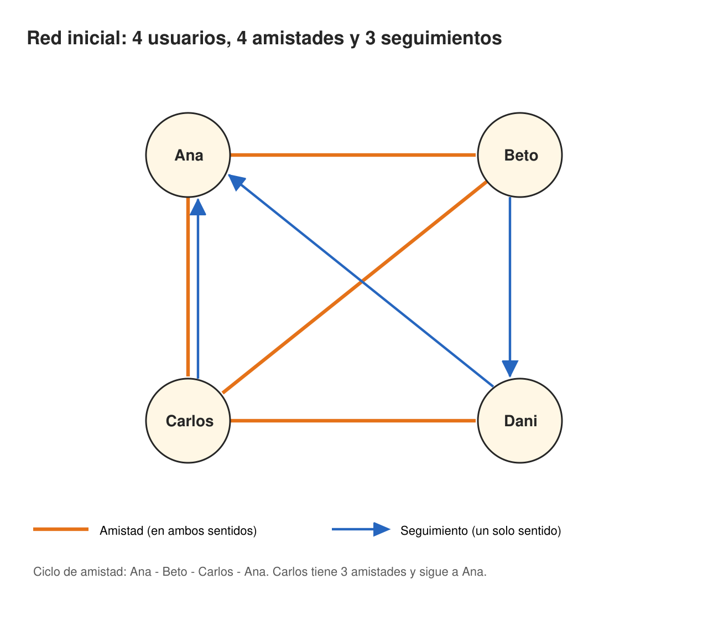

# Reparto de la actividad · Red social con grafo dinámico (Grupo 2)

Actividad facilitada por el Grupo 5 (repositorio de referencia: <https://github.com/gamboarommel580-rgb/APE4-Grupo5-RedSocial>; repositorio del grupo: <https://github.com/jampiercamacho94-cloud/red-social-grafo-dinamico>).
Presentes en clase: **Damian, Jampier, Joel y Luis**. Cada uno tiene una parte propia para no pisarse.

## Resumen: quién hace qué

| Integrante | En la actividad (Padlet) | Clases que programa |
|---|---|---|
| **Luis Silva** | 1. Crear a Ana, Beto, Carlos y Dani | `enums/TipoRelacion`, `modelo/Persona`, `modelo/Vertice`, `modelo/Arista`, `app/Menu` |
| **Josue Jampier Camacho** | 2. Amistades y seguimientos con comentarios | `pruebas/PruebasRedSocial` |
| **Darwin Tisalema (Joel)** | 3. Cambios que pida el moderador | `app/Main` |
| **Damian Cunalata** | 4 y 5. Eliminar a Carlos y publicar el esquema | `negocio/RedSocial` y el `README.md` |

Nadie toca una clase que no es suya. Si necesitas algo de otra clase, se lo pides a su responsable.

## Reglas que todos deben respetar

| Regla | Qué significa en la red |
|---|---|
| Sin lazos | Nadie puede ser amigo de sí mismo (ni seguirse a sí mismo). |
| Amistad recíproca | Si Ana es amiga de Beto, Beto es amigo de Ana: es **una** arista no dirigida (Ana — Beto). |
| Seguimiento en un sentido | Si Dani sigue a Ana, Ana **no** sigue a Dani: es una arista dirigida (Dani → Ana). |
| Eliminar borra todo | Al eliminar un usuario desaparecen sus amistades, a quién sigue y quién lo sigue. |

Notación para los comentarios (todos igual): `AMISTAD: Ana - Beto` y `SIGUE: Dani -> Ana`.

## Red inicial acordada

- Usuarios: Ana, Beto, Carlos, Dani.
- Amistades: Ana — Beto, Ana — Carlos, Beto — Carlos, Carlos — Dani.
- Seguimientos: Dani → Ana, Beto → Dani, Carlos → Ana.



Con esto hay un ciclo de amistad (Ana — Beto — Carlos — Ana) y Carlos queda con muchas conexiones, así que el paso 4 sí se nota.

---

## 1. Luis — Crear los cuatro usuarios (instrucción 1)

1. Crea una publicación por usuario: **Ana**, **Beto**, **Carlos** y **Dani** (nombre y un ID corto: A, B, C, D).
2. Revisa que no haya usuarios repetidos ni con otro nombre ("ana" y "Ana" son la misma persona).
3. Toma una captura de los 4 usuarios creados.
4. Opcional: ejecuta el `Menu` del repo del Grupo 5 y registra a los mismos cuatro (`registrarPersona`) para comprobar que el programa los acepta y rechaza un duplicado.

**Entrega:** captura de los 4 usuarios y una línea diciendo que no hubo duplicados.

**Clases que programa Luis:**

| Archivo | Qué debe tener |
|---|---|
| `src/enums/TipoRelacion.java` | `AMISTAD` y `SEGUIR`. Ya está completo; solo revisarlo. |
| `src/modelo/Persona.java` | Atributos `usuario` y `nombre` (`final`), constructor, `getUsuario()`, `getNombre()` y `toString()`. |
| `src/modelo/Vertice.java` | Atributos `persona`, `aristas` (primera relación, `null` si no tiene) y `sig` (siguiente persona); constructor, getters y `setAristas`, `setSig`. |
| `src/modelo/Arista.java` | Atributos `destino` (`Vertice`), `tipo` (`TipoRelacion`) y `sig`; constructor, getters y `setSig`. |
| `src/app/Menu.java` | Menú con `switch`: 1 registrar, 2 amistad, 3 seguir, 4 quitar amistad, 5 dejar de seguir, 6 eliminar usuario, 7 ver vecinos, 8 mostrar red, 0 salir. Valida que la opción sea un número. |

Commits sugeridos: `feat: agrega modelo de la red (Persona, Vertice, Arista)` y luego `feat: agrega menu de consola con switch`.

## 2. Jampier — Crear amistades y seguimientos con comentarios (instrucción 2)

1. En la publicación de cada usuario, comenta sus relaciones con la notación de arriba, usando la **red inicial acordada**.
2. Cada amistad se comenta **en los dos usuarios** (es recíproca); cada seguimiento solo en el que sigue.
3. Llena esta tabla y súbela como captura o texto:

| Usuario | Amigos | Sigue a | Lo siguen |
|---|---|---|---|
| Ana | Beto, Carlos | — | Dani, Carlos |
| Beto | Ana, Carlos | Dani | — |
| Carlos | Ana, Beto, Dani | Ana | — |
| Dani | Carlos | Ana | Beto |

4. Revisa que no haya lazos ni amistades repetidas.

**Entrega:** captura de los comentarios y la tabla de la red inicial.

**Clase que programa Jampier:**

| Archivo | Qué debe tener |
|---|---|
| `src/pruebas/PruebasRedSocial.java` | Un método `verificar(nombre, condicion)` que imprima `[OK]` o `[FALLA]` y cuente los aciertos. Pruebas mínimas: registrar 4 usuarios; rechazar usuario repetido; rechazar amistad y seguimiento consigo mismo; la amistad Ana–Beto se ve desde los dos lados; Dani sigue a Ana pero Ana no sigue a Dani; rechazar amistad repetida; quitar una amistad la borra de los dos lados; al eliminar a Carlos nadie lo tiene como amigo, nadie lo sigue y él ya no existe. Al final imprime `N/N pruebas OK`. |

Commit sugerido: `test: agrega pruebas de las reglas de la red social`.

## 3. Joel — Modificar relaciones según el moderador (instrucción 3)

1. Anota **cada** indicación que dé el moderador, en orden.
2. Antes de aplicarla, revisa si cumple las reglas:
   - Si pide una amistad consigo mismo → se rechaza (sin lazos).
   - Si pide una amistad que ya existe → se rechaza (repetida).
   - Si pide quitar una amistad → se quita **de los dos lados**.
   - Si pide quitar un seguimiento → se quita solo ese sentido.
3. Aplica las válidas editando los comentarios y llena la bitácora:

| # | Indicación del moderador | ¿Válida? | Regla | Cambio hecho |
|---|---|---|---|---|
| 1 | | | | |
| 2 | | | | |

4. Toma una captura de la red después de los cambios (antes de eliminar a Carlos).

**Entrega:** bitácora completa y captura de la red modificada.

**Clase que programa Joel:**

| Archivo | Qué debe tener |
|---|---|
| `src/app/Main.java` | La actividad paso a paso, imprimiendo un título por paso y la red con `mostrarRed()` al final de cada uno: (1) registrar a Ana, Beto, Carlos y Dani; (2) crear la red inicial acordada; (3) aplicar los cambios del moderador que anotó en su bitácora, mostrando si cada uno se aceptó o se rechazó; (4) eliminar a Carlos; (5) mostrar la red final y los amigos, seguidos y seguidores de cada usuario. |

Commit sugerido: `feat: agrega demo de la actividad en Main`.

## 4. Damian — Eliminar a Carlos y publicar el esquema final (instrucciones 4 y 5)

1. Antes de borrar, lista **todas** las conexiones de Carlos con la red que dejó Joel (amistades, a quién sigue y quién lo sigue).
2. Elimina a Carlos y borra cada una de esas conexiones; verifica que ningún otro usuario lo siga nombrando.
3. Dibuja el esquema final: amistades con línea sin flecha y seguimientos con flecha.
4. Publica el esquema y redacta el README del grupo.

Si el moderador no cambió nada, al eliminar a Carlos se borran: Ana — Carlos, Beto — Carlos, Carlos — Dani y Carlos → Ana. La red final queda:

```
Ana —— Beto          (amistad)
Dani ──▶ Ana         (seguimiento)
Beto ──▶ Dani        (seguimiento)
```

**Entrega:** lista de conexiones eliminadas, esquema final publicado y README.

**Clase que programa Damian:**

| Archivo | Qué debe tener |
|---|---|
| `src/negocio/RedSocial.java` | Lista enlazada de `Vertice` (sin `HashMap` ni `ArrayList`). Métodos: `registrarPersona(usuario, nombre)`, `agregarAmistad(a, b)` y `eliminarAmistad(a, b)` en los dos sentidos, `seguir(a, b)` y `dejarDeSeguir(a, b)` en un sentido, `eliminarPersona(usuario)` que borra al usuario y **todas** las aristas que llegan a él, `listarAmigos`, `listarSeguidos`, `listarSeguidores` y `mostrarRed`. Todos rechazan lazos, repetidos y usuarios inexistentes devolviendo `false` o `null`. |

Commits sugeridos: `feat: agrega alta de personas y relaciones en RedSocial` y `feat: agrega eliminarPersona y consultas de vecinos`.

---

## Parte de código (misma distribución de paquetes que el Grupo 5)

Cada archivo tiene **un solo responsable** para no tener conflictos al subir. El esqueleto ya está en `src/` con el nombre del responsable en cada clase.

| Paquete | Archivo | Responsable | Qué debe tener |
|---|---|---|---|
| `enums` | `TipoRelacion.java` | Luis | `AMISTAD` (no dirigida) y `SEGUIR` (dirigida). Ya está completo. |
| `modelo` | `Persona.java` | Luis | `usuario`, `nombre`, constructor, getters y `toString`. |
| `modelo` | `Vertice.java` | Luis | `persona`, `aristas` (inicio de su lista de relaciones), `sig`, getters y setters. |
| `modelo` | `Arista.java` | Luis | `destino`, `tipo` (`TipoRelacion`), `sig`, getters y `setSig`. |
| `negocio` | `RedSocial.java` | Damian | Todas las operaciones: `registrarPersona`, `agregarAmistad`, `eliminarAmistad`, `seguir`, `dejarDeSeguir`, `eliminarPersona` (borra todas sus conexiones), `listarAmigos`, `listarSeguidos`, `listarSeguidores` y `mostrarRed`. Sin `HashMap` ni `ArrayList`. |
| `app` | `Main.java` | Joel | Demo con los pasos de la actividad: crea a Ana, Beto, Carlos y Dani, la red inicial, los cambios del moderador, elimina a Carlos y muestra la red final. |
| `app` | `Menu.java` | Luis | Menú de consola con `switch` para registrar, relacionar, eliminar y mostrar la red. |
| `pruebas` | `PruebasRedSocial.java` | Jampier | Pruebas sin JUnit: sin lazos, amistad en ambos sentidos, seguimiento en un sentido, duplicados rechazados y que al eliminar a Carlos no quede ninguna conexión suya. |

Orden para subir: Luis (`enums` y `modelo`) → Damian (`RedSocial`) → Joel (`Main`), Luis (`Menu`) y Jampier (`PruebasRedSocial`) en paralelo, porque los tres usan `RedSocial`.

Compilar y ejecutar desde la raíz del repositorio (PowerShell):

```powershell
javac -encoding UTF-8 -d out (Get-ChildItem -Recurse -Filter *.java src).FullName
java -cp out app.Main
java -cp out app.Menu
java -cp out pruebas.PruebasRedSocial
```

## Orden de trabajo en la actividad (Padlet)

Luis (usuarios) → Jampier (relaciones) → Joel (cambios del moderador) → Damian (eliminar a Carlos y esquema).
Cada uno avisa al siguiente cuando termina, porque cada paso parte de la red que dejó el anterior.
