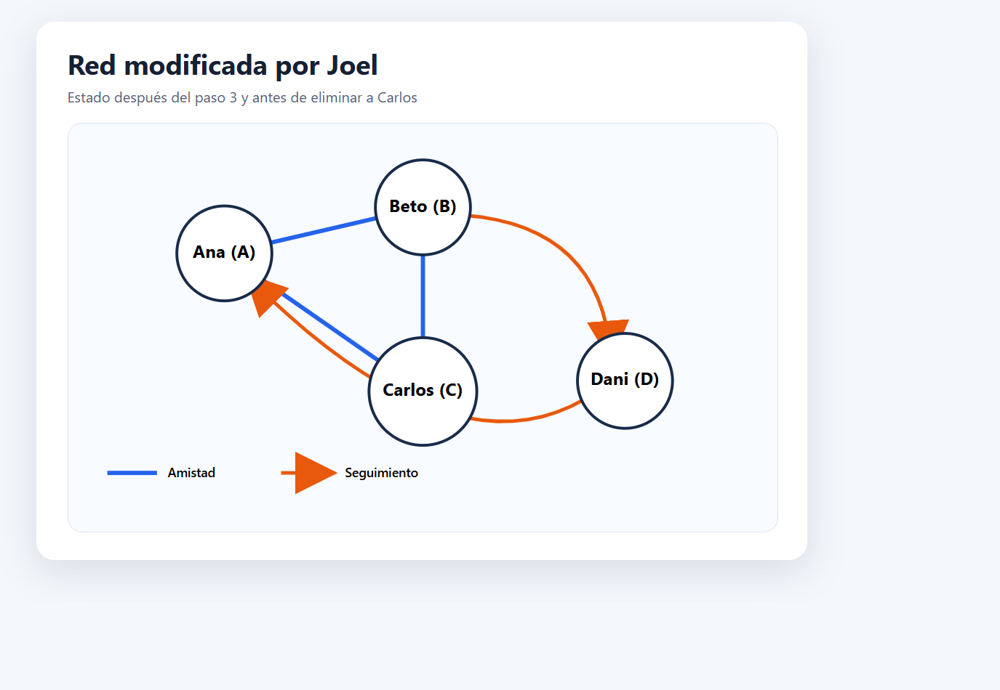
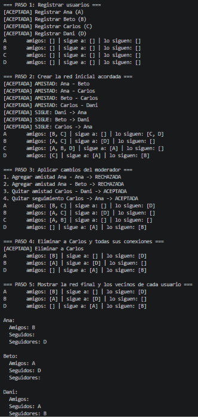

# Bitácora de Joel — cambios del moderador

Responsable: **Darwin Tisalema (Joel)**  
Instrucción: modificar las relaciones de la red según las indicaciones del moderador.

> Esta bitácora documenta una demostración de las cuatro reglas asignadas a Joel en `docs/REPARTO.md`.

## Validaciones que se aplicarán

- Una amistad consigo mismo se rechaza por ser un lazo.
- Una amistad existente se rechaza por estar repetida.
- Al quitar una amistad, la relación se elimina de ambos usuarios.
- Al quitar un seguimiento, solo se elimina el sentido indicado.
- También se rechazan usuarios inexistentes y seguimientos repetidos.

## Bitácora

| # | Indicación del moderador | ¿Válida? | Regla | Cambio hecho |
|---|---|---|---|---|
| 1 | Agregar amistad Ana - Ana | No | Sin lazos | Se rechazó; la red no cambió. |
| 2 | Agregar amistad Ana - Beto | No | Amistad repetida | Se rechazó; la amistad ya existía. |
| 3 | Quitar amistad Carlos - Dani | Sí | La amistad se quita de ambos lados | Carlos dejó de ser amigo de Dani y Dani dejó de ser amiga de Carlos. |
| 4 | Quitar seguimiento Carlos -> Ana | Sí | El seguimiento se quita en un solo sentido | Carlos dejó de seguir a Ana. |

## Evidencia

La captura de la red modificada se tomó después de ejecutar el paso 3 de `app.Main` y antes de que el paso 4 eliminara a Carlos.

### Red modificada

### Ejecución de `Main`

